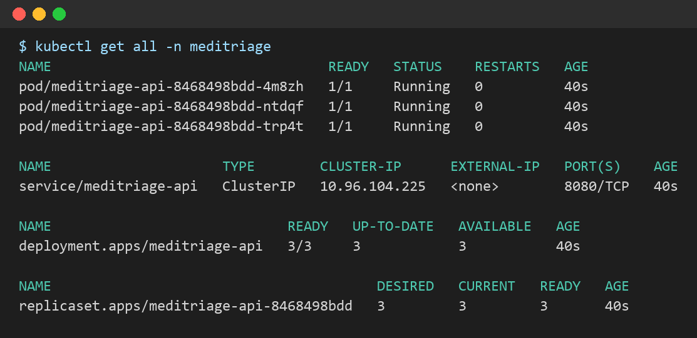

### En Kubernetes

El clúster local se levanta con kind; los pasos están en [cluster-local/](cluster-local/README.md).

## Seguridad: hallazgos y excepciones

### Cómo priorizamos los hallazgos

Consideramos la severidad (CVSS), si el código vulnerable es accesible
desde internet y si el hallazgo puede afectar datos de pacientes.

### Plazos de corrección

| Severidad | Plazo |
| --- | --- |
| Crítica | Menos de 7 días |
| Alta | Menos de 30 días |
| Media | Menos de 90 días |

### Cómo pedimos una excepción

El DevSecOps Lead propone la excepción y la Product Owner la aprueba.
La decisión se registra en la descripción del PR y en un archivo VEX,
con el motivo y la fecha de vencimiento.

### Falsos positivos

Si un hallazgo es un falso positivo, ajustamos la regla de detección.
Cualquier uso de `nosec` debe tener una justificación.

## Flujo de trabajo

Las convenciones de ramas, commits y Pull Requests están en [CONTRIBUTING.md](CONTRIBUTING.md).

La rama `main` requiere Pull Request y aprobación de otro integrante antes de integrar
cambios.
