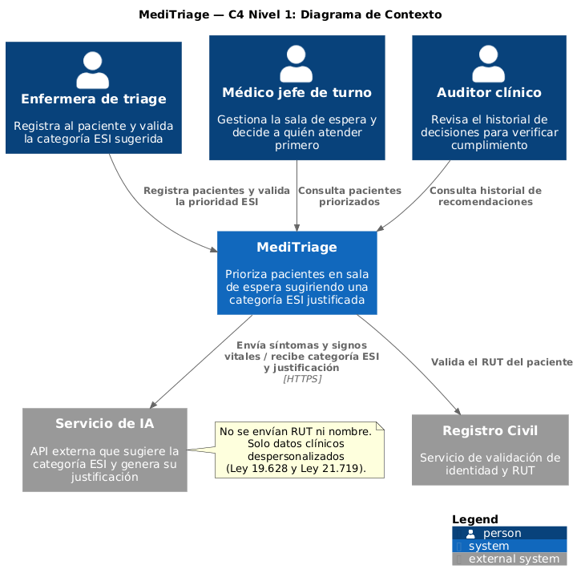
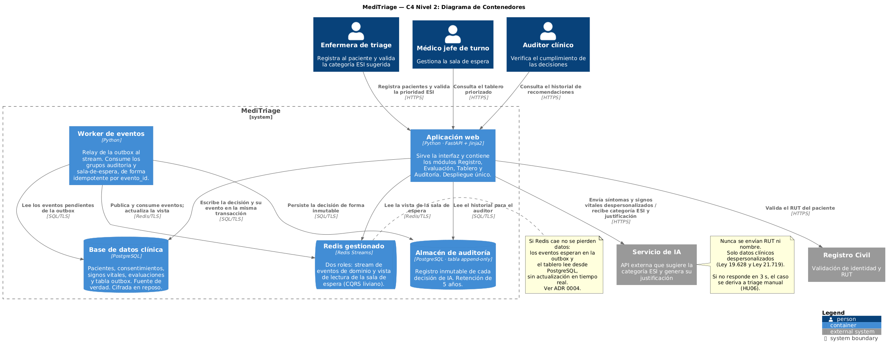

# MediTriage — Triage clínico asistido por IA

Sistema que utiliza inteligencia artificial para ayudar a ordenar y priorizar pacientes según sus síntomas y signos vitales, en la sala de espera de centros de atención primaria.

## Objetivo

Reducir el tiempo de priorización del triage de 25 minutos a menos de 3 minutos, entregando a la enfermera una sugerencia de categoría ESI (1 a 5) acompañada de su justificación.

## Equipo

| Integrante | Rol |
|---|---|
| Constanza Valdivia | Product Owner |
| Fernando Ureta | Tech Lead · AI/Data Lead |
| Matías Sepúlveda | DevSecOps Lead |
| Matías Casa | QA Lead |

## Documentación

**Acuerdos del equipo**

- [CHARTER](CHARTER.md) — misión, roles, valores, política de uso de IA y Definition of Done.
- [CONTRIBUTING](CONTRIBUTING.md) — cómo se contribuye: ramas, commits y Pull Requests.

**Requisitos y producto**

- [Impact Map](docs/impact-map.md) — objetivo, actores, impactos, entregables y trazabilidad.
- [Backlog](docs/backlog.md) — historias de usuario, priorización MoSCoW y checklist INVEST.
- [Escenarios Gherkin](docs/scenarios/) — criterios de aceptación, un archivo por historia.

## Arquitectura

MediTriage utiliza el modelo C4 para documentar su arquitectura y representar sus componentes y relaciones.

### Nivel 1 — Diagrama de contexto

Representa el sistema MediTriage, sus usuarios principales y los servicios externos con los que interactúa.



[Ver código fuente del diagrama](docs/c4/l1-context.puml).

### Nivel 2 — Diagrama de contenedores

Representa los contenedores del sistema: las aplicaciones y bases de datos que lo forman, sus responsabilidades y las tecnologías que usan.



[Ver código fuente del diagrama](docs/c4/l2-container.puml).

### Decisiones y documentación arquitectónica

- [ADR 0001 — Elección de iniciativa](docs/adr/0001-eleccion-iniciativa.md).
- [ADR 0002 — Elección del estilo arquitectónico](docs/adr/0002-estilo-arquitectonico.md).
- [ADR 0003 — Decisión cloud y servicios gestionados](docs/adr/0003-cloud-style.md).
- [ADR 0004 — Datos y eventos](docs/adr/0004-datos-y-eventos.md).
- [ADR 0005 — Plataforma de despliegue: Kubernetes e infraestructura como código](docs/adr/0005-plataforma-k8s.md).
- [Atributos de calidad](docs/arch/atributos-calidad.md) — los 3 NFRs prioritarios.

## Seguridad

- [Threat Model STRIDE](docs/threat-model.md) — amenazas del flujo de triage y sus mitigaciones.

## Cómo correr la aplicación

Requiere Python 3.11.

```bash
python -m venv .venv
.venv/Scripts/activate            # Windows
# En Linux o macOS: source .venv/bin/activate

pip install -r requirements-dev.txt

python -m src.main                # API en http://localhost:8080
pytest --cov=src                  # Pruebas con cobertura
ruff check .                      # Lint
```

Con la aplicación corriendo, la documentación interactiva está en:

http://localhost:8080/docs

### Con Docker

```bash
docker build -t meditriage .
docker run -p 8080:8080 meditriage
```

### En Kubernetes

El clúster local se levanta con kind. Los pasos están en [cluster-local/](cluster-local/README.md).


## Seguridad: hallazgos y excepciones

### Cómo priorizamos los hallazgos

Consideramos la severidad (CVSS), si el código vulnerable es accesible desde internet y si el hallazgo puede afectar datos de pacientes.

### Plazos de corrección

| Severidad | Plazo |
|---|---|
| Crítica | Menos de 7 días |
| Alta | Menos de 30 días |
| Media | Menos de 90 días |

### Cómo pedimos una excepción

El DevSecOps Lead propone la excepción y la Product Owner la aprueba. La decisión se registra en la descripción del PR y en un archivo VEX, con el motivo y la fecha de vencimiento.

### Falsos positivos

Si un hallazgo es un falso positivo, ajustamos la regla de detección. Cualquier uso de `nosec` debe tener una justificación.

## Flujo de trabajo

Las convenciones de ramas, commits y Pull Requests están en [CONTRIBUTING.md](CONTRIBUTING.md).

La rama `main` requiere Pull Request y aprobación de otro integrante antes de integrar cambios.
