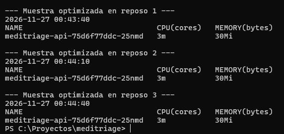
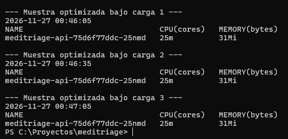

# Evidencia 02 — Configuración optimizada

Transcripción de comandos y capturas del 27/11/2026 (hora local).

```powershell
kubectl --context kind-meditriage delete pod finops-load -n meditriage-finops-test
kubectl --context kind-meditriage set resources deployment/meditriage-api -n meditriage-finops-test --containers=api --requests=cpu=100m,memory=128Mi --limits=cpu=500m,memory=256Mi
kubectl --context kind-meditriage scale deployment/meditriage-api -n meditriage-finops-test --replicas=1
kubectl --context kind-meditriage rollout status deployment/meditriage-api -n meditriage-finops-test --timeout=120s
```

Salida: `deployment "meditriage-api" successfully rolled out`. Pod `meditriage-api-75d6f77ddc-25nmd` Running 1/1, cero reinicios en la comprobación inicial. El segundo pod estaba Terminating; las muestras posteriores muestran solo el pod restante.

## Reposo

Comando: `kubectl --context kind-meditriage top pods -n meditriage-finops-test -l app=meditriage`.

| Hora | CPU | RAM |
|---|---:|---:|
| 00:43:40 | 3m | 30Mi |
| 00:44:10 | 3m | 30Mi |
| 00:44:40 | 3m | 30Mi |



## Carga ligera

Se recreó el generador y se repitió el patrón de diez peticiones secuenciales y pausa de un segundo descrito en [evidencia 01](01-mediciones-antes.md). Mismo comando de muestreo.

| Hora | CPU | RAM |
|---|---:|---:|
| 00:46:05 | 25m | 31Mi |
| 00:46:35 | 25m | 31Mi |
| 00:47:05 | 25m | 31Mi |



Promedios: reposo 3m/30Mi; carga 25m/31Mi. No se registró conteo de peticiones, errores ni latencia.
