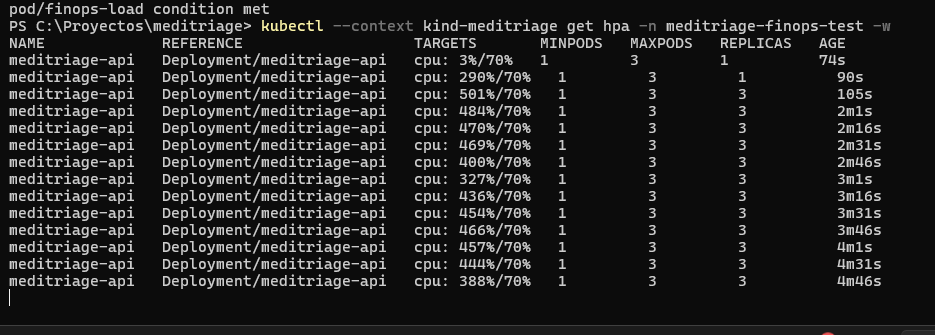
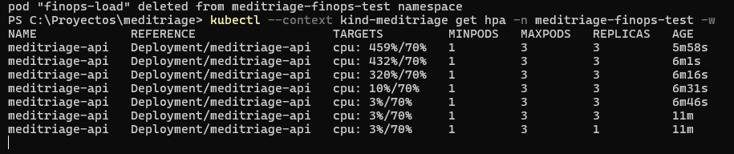

# Evidencia 03 — HPA

Ensayo independiente de la comparación FinOps, namespace aislado, 27/11/2026.

```powershell
kubectl --context kind-meditriage delete pod finops-load -n meditriage-finops-test
kubectl --context kind-meditriage autoscale deployment meditriage-api -n meditriage-finops-test --min=1 --max=3 --cpu-percent=70
kubectl --context kind-meditriage describe hpa meditriage-api -n meditriage-finops-test
```

El flag `--cpu-percent` emitió advertencia de deprecación, no error. Alternativa: `--cpu=70%`.

```text
CreationTimestamp: Fri, 27 Nov 2026 00:49:07 -0300
resource cpu on pods (as a percentage of request): 3% (3m) / 70%
Min replicas: 1
Max replicas: 3
Deployment pods: 1 current / 1 desired
AbleToScale     True    ReadyForNewScale
ScalingActive   True    ValidMetricFound
ScalingLimited  False   DesiredWithinRange
Events: <none>
```

## Escalado ascendente

Recrear el generador BusyBox descrito en evidencia 01. Ejecutar en otra terminal:

```powershell
kubectl --context kind-meditriage exec -n meditriage-finops-test finops-load -- sh -c 'for i in 1 2 3 4 5 6 7 8; do (while true; do wget -qO /dev/null http://meditriage-api:8080/health || echo ERROR; done) & done; wait'
kubectl --context kind-meditriage get hpa -n meditriage-finops-test -w
```

| Edad HPA | CPU/objetivo | Réplicas |
|---|---|---:|
| 74s | 3%/70% | 1 |
| 90s | 290%/70% | 1 |
| 105s | 501%/70% | 3 |
| 4m46s | 388%/70% | 3 |



## Escalado descendente

Detener carga y monitoreo con Ctrl+C en sus respectivas terminales. Ejecutar:

```powershell
kubectl --context kind-meditriage delete pod finops-load -n meditriage-finops-test
kubectl --context kind-meditriage get hpa -n meditriage-finops-test -w
```

| Edad HPA | CPU/objetivo | Réplicas |
|---|---|---:|
| 5m58s | 459%/70% | 3 |
| 6m1s | 432%/70% | 3 |
| 6m16s | 320%/70% | 3 |
| 6m31s | 10%/70% | 3 |
| 6m46s | 3%/70% | 3 |
| 11m | 3%/70% | 3 |
| 11m | 3%/70% | 1 |



Resultado: ciclo 1→3→1 observado. La edad del HPA no equivale a tiempo exacto de respuesta desde inicio de carga. La reducción es compatible con la ventana de estabilización habitual, no se midió su duración exacta. La saturación por encima del objetivo con tres réplicas impide afirmar suficiencia de capacidad. El porcentaje se refiere al request, no al límite de CPU.
