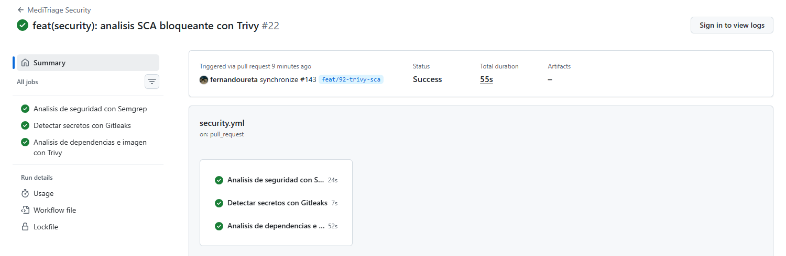
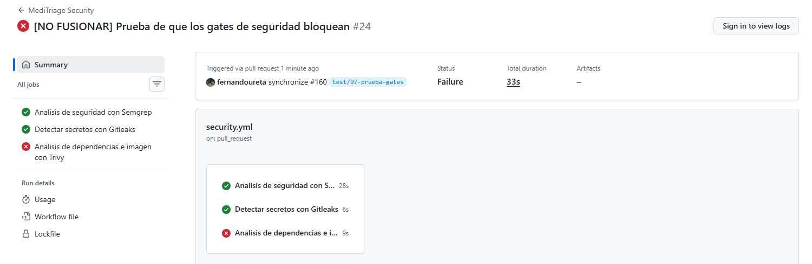
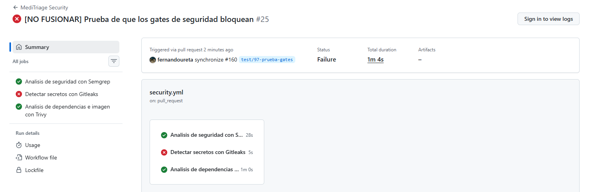

# Prueba de que los gates de seguridad bloquean

Issue #97 · Sesión 09 · 27/11/2026

La rúbrica de la S09 no pide solo que existan los escaneos: pide que sean **bloqueantes**. Un
gate que nunca se vio fallar no está demostrado. Esta prueba hace fallar cada gate de
`.github/workflows/security.yml` con un caso propio, y verifica que falle **ese** gate y no
los otros.

## Cómo se hizo

- **Dónde:** en el PR #160, un borrador que nunca se fusionó. Partió de la rama del #143,
  porque el SCA con Trivy todavía no estaba en `main`.
- **Cómo:** un caso por commit. Cada paso revierte el caso anterior antes de agregar el
  siguiente, para que en cada ejecución haya una sola cosa mal.
- **Con datos falsos:** el `print` no imprime ningún RUT real (en la prueba no corre nada), y
  el token se generó al azar y nunca fue una credencial.
- **Al terminar:** el PR se cerró sin fusionar y su rama se borró. Gitleaks revisa todas las
  ramas, así que mientras la rama existía el token falso hacía fallar el check en los demás
  PRs.

## Resultado

| Paso | Commit | Qué se agregó | SAST (Semgrep) | SCA (Trivy) | Secretos (Gitleaks) |
|---|---|---|---|---|---|
| 0 | `7afb9b6` | Nada: es la rama del #143, la línea base | ✅ | ✅ | ✅ |
| 1 | `d093315` | Un `print` del RUT en `src/registro/rutas.py` | ❌ | ✅ | ✅ |
| 2 | `7774db7` | `django==2.2.0` en `requirements.txt` | ✅ | ❌ | ✅ |
| 3 | `3848fbf` | Un token falso en `prueba_gate_secretos.py` | ✅ | ✅ | ❌ |
| 4 | `155a597` | Se revierte el token | ✅ | ✅ | ❌ |

**Cada gate falló con su caso, y solo con su caso.** Los demás checks del PR (Ruff, pruebas y
Spectral) siguieron en verde en todos los pasos.

| Paso | Ejecución de `security.yml` |
|---|---|
| 0 | [46025755561](https://github.com/constanzavaldiviadiaz-svg/meditriage/actions/runs/46025755561) |
| 1 | [46026003257](https://github.com/constanzavaldiviadiaz-svg/meditriage/actions/runs/46026003257) |
| 2 | [46027010582](https://github.com/constanzavaldiviadiaz-svg/meditriage/actions/runs/46027010582) |
| 3 | [46027282546](https://github.com/constanzavaldiviadiaz-svg/meditriage/actions/runs/46027282546) |
| 4 | [46027623244](https://github.com/constanzavaldiviadiaz-svg/meditriage/actions/runs/46027623244) |

GitHub borra los logs de las ejecuciones a los 90 días. Por eso los extractos y las capturas
quedan aquí.

### Paso 0 · Línea base: los tres checks en verde



### Paso 1 · SAST: un `print` del RUT

Lo detecta una de nuestras reglas propias, `meditriage-pii-en-logs`, y no una regla genérica:
la Ley 19.628 exige enmascarar los datos personales en los logs.

```text
    src/registro/rutas.py
   ❯❯❱ semgrep.meditriage-pii-en-logs
          ❰❰ Blocking ❱❱
          El RUT o el nombre del paciente llegan a un log o a la salida estándar. La Ley 19.628 exige
          enmascarar los datos personales: registra el pacienteId o usa enmascarar_rut().

           65┆ print("Registrando paciente", datos.rut)  # PRUEBA #97: debe bloquear el SAST

 • Findings: 1 (1 blocking)
```


### Paso 2 · SCA: una dependencia con CVE críticos

`django==2.2.0` tiene seis vulnerabilidades CRITICAL conocidas, todas con parche. Falla la
primera pasada de Trivy, la que bloquea toda CRITICAL, tenga o no parche.

```text
Total: 6 (CRITICAL: 6)
│ django  │ CVE-2019-14234 │ CRITICAL │ fixed  │ 2.2.0 │ 1.11.23, 2.1.11, 2.2.4 │ Django: SQL injection possibility in key and index lookups
│         │ CVE-2019-19844 │          │        │       │ 1.11.27, 2.2.9, 3.0.1  │ Django: crafted email address allows account takeover
│         │ CVE-2020-7471  │          │        │       │ 1.11.28, 2.2.10, 3.0.3 │ django: potential SQL injection via StringAgg(delimiter)
│         │ CVE-2022-28346 │          │        │       │ 2.2.28, 3.2.13, 4.0.4  │ Django: SQL injection in QuerySet.annotate(),aggregate() and
│         │ CVE-2022-28347 │          │        │       │                        │ Django: SQL injection via QuerySet.explain(options) on
│         │ CVE-2025-64459 │          │        │       │ 5.2.8, 5.1.14, 4.2.26  │ django: Django SQL injection
```



### Paso 3 · Secretos: un token en el código

```text
INF 145 commits scanned.
WRN leaks found: 1
```

El log no muestra el valor encontrado: el workflow corre Gitleaks con `--redact`, así que un
secreto real tampoco quedaría expuesto en los logs del pipeline.



### Paso 4 · Revertir el token no basta

Después de borrar el token en un commit nuevo, Gitleaks **sigue fallando**:

```text
INF 145 commits scanned.
WRN leaks found: 1
```

Es lo esperado: el workflow descarga el historial completo (`fetch-depth: 0`) y revisa todos
los commits de todas las ramas (`--log-opts="--all"`), y el token sigue en el commit que lo
agregó. **Por eso un secreto que llegó al repositorio se rota, aunque después se borre.** El
procedimiento está en `docs/security/secretos.md`.


## Lo que la prueba no cubre

- **Que el merge se bloquee.** El check falla, pero lo que impide fusionar es que el check sea
  obligatorio en la protección de `main`. Hoy lo son Semgrep y Gitleaks. **El check de Trivy
  hay que agregarlo como obligatorio cuando se fusione el #143.**
- **Los gates de la S10:** el IaC scan (#116), el DAST (#117) y Kyverno rechazando una imagen
  sin firma (#118). Se prueban de la misma forma cuando estén en `main`.

## Cómo repetirla

1. Crear una rama desde `main` y abrir un PR en borrador, marcado **NO FUSIONAR**.
2. Un commit por caso, revirtiendo el anterior: un `print` de `datos.rut` en `src/`, una
   dependencia vieja con CVE CRITICAL en `requirements.txt`, y un token falso generado al azar
   con forma de clave (`API_KEY = "..."` con 40 caracteres aleatorios).
3. Revisar en cada ejecución de `security.yml` que falle solo el job esperado.
4. Cerrar el PR sin fusionar y **borrar la rama de inmediato**.
