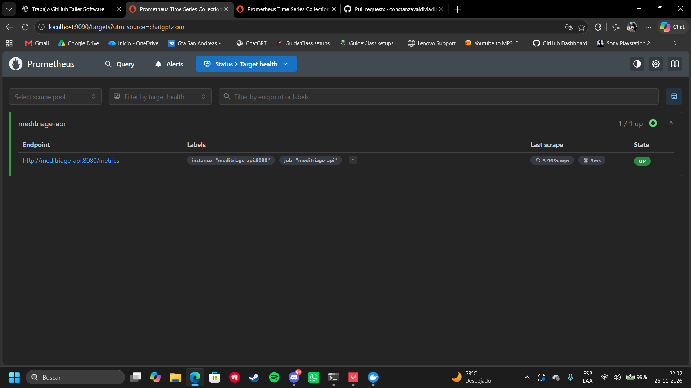
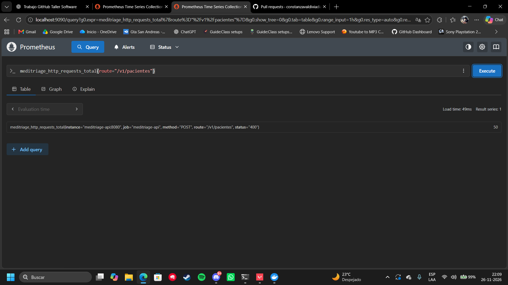
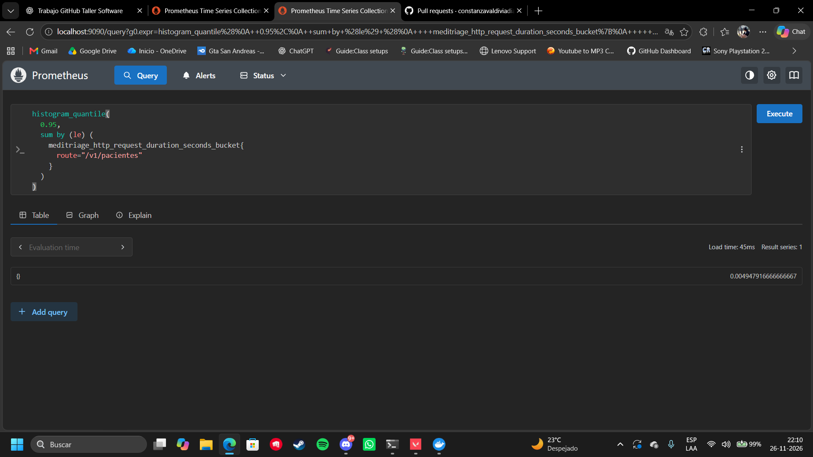
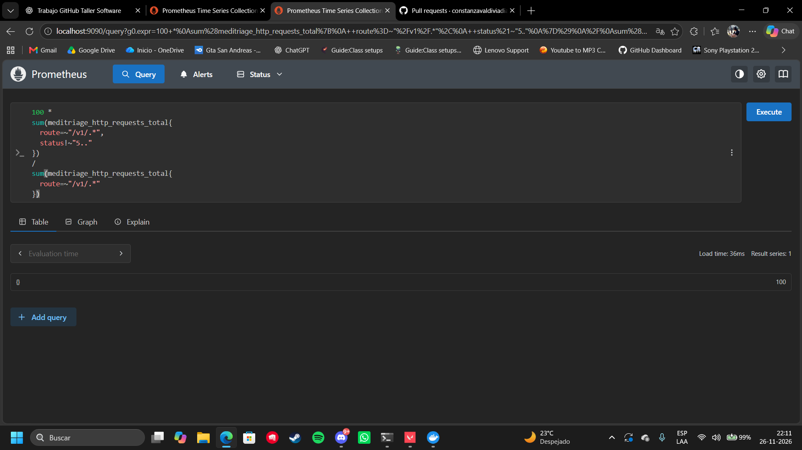

# SLOs y observabilidad de MediTriage

## 1. Propósito

Este documento define los indicadores de nivel de servicio (SLI),
los objetivos de nivel de servicio (SLO) y los presupuestos de error
de MediTriage, de acuerdo con las restricciones del proyecto.

Responsable: DevSecOps Lead.

## 2. Objetivos de nivel de servicio

| Indicador (SLI) | Objetivo (SLO) | Error budget |
|---|---|---|
| Disponibilidad del servicio | 99,5% mensual | 0,5% |
| Latencia de evaluación de triage | p95 inferior a 3 segundos | Hasta 5% de evaluaciones fuera del umbral |
| Decisiones clínicas auditadas | 100% | 0 decisiones sin auditar |

## 3. Presupuesto de error

### Disponibilidad

Para un mes de 30 días:

- Tiempo total: 43.200 minutos.
- Disponibilidad requerida: 99,5%.
- Indisponibilidad permitida: 0,5%.
- Error budget: 216 minutos.
- Equivalencia: 3 horas y 36 minutos.

El presupuesto se ajusta según la duración del mes.

| Duración del mes | Indisponibilidad permitida |
|---|---|
| 28 días | 3 h 21 min 36 s |
| 30 días | 3 h 36 min |
| 31 días | 3 h 43 min 12 s |

### Latencia

El percentil 95 de las evaluaciones de triage debe mantenerse
por debajo de 3 segundos.

Como máximo, un 5% de las evaluaciones puede quedar fuera
del umbral establecido, sujeto al cumplimiento del p95.

### Auditoría

El presupuesto de error es cero.

Toda decisión clínica debe contar con un registro de auditoría
persistente y trazable. Una decisión sin registro constituye
un incumplimiento del objetivo.

## 4. Instrumentación

La aplicación expone métricas en formato Prometheus mediante
el endpoint interno `/metrics`.

| Métrica | Tipo | Propósito |
|---|---|---|
| `meditriage_http_requests_total` | Counter | Contabilizar solicitudes HTTP por método, ruta y estado |
| `meditriage_http_request_duration_seconds` | Histogram | Medir la duración de las solicitudes HTTP |

Las rutas `/health`, `/ready` y `/metrics` se excluyen
de la instrumentación HTTP para evitar distorsiones
producidas por sondas y consultas de monitorización.

El manifiesto Ingress utiliza rutas explícitas para evitar
la exposición pública directa de `/metrics`.

## 5. Consultas PromQL

### Disponibilidad basada en solicitudes HTTP

```promql
100 *
sum(increase(meditriage_http_requests_total{
  route=~"/v1/.*",
  status!~"5.."
}[30d]))
/
sum(increase(meditriage_http_requests_total{
  route=~"/v1/.*"
}[30d]))
```

Esta consulta considera las respuestas HTTP no 5xx como
solicitudes atendidas por el servicio.

Es un indicador de disponibilidad basado en solicitudes,
no una medición directa del tiempo de indisponibilidad.

Debe complementarse con sondas externas para detectar
interrupciones completas del servicio.

La ausencia de tráfico no demuestra disponibilidad.

### Latencia HTTP p95

```promql
histogram_quantile(
  0.95,
  sum by (le) (
    rate(meditriage_http_request_duration_seconds_bucket{
      route=~"/v1/.*"
    }[5m])
  )
)
```

Esta consulta permite observar la latencia HTTP general
de las rutas de negocio.

No representa todavía el SLI específico de evaluación
clínica de triage.

### Tasa de errores HTTP 5xx

```promql
100 *
sum(rate(meditriage_http_requests_total{
  route=~"/v1/.*",
  status=~"5.."
}[5m]))
/
sum(rate(meditriage_http_requests_total{
  route=~"/v1/.*"
}[5m]))
```

### Cobertura de auditoría

El indicador se calculará mediante la relación entre
decisiones clínicas únicas con auditoría persistida
y el total de decisiones clínicas emitidas.

SLI = (decisiones auditadas / decisiones emitidas) * 100

La instrumentación específica queda pendiente hasta
la implementación del módulo de auditoría.

## 6. Logging estructurado y privacidad

Cada solicitud HTTP instrumentada genera un evento JSON
con los siguientes atributos:

- timestamp
- event
- trace_id
- method
- route
- status
- duration_ms

Los eventos no incluyen cuerpos de solicitudes, parámetros
de consulta ni datos clínicos.

Los identificadores de trazabilidad proporcionados por
clientes se enmascaran mediante `[REDACTED]` en estos logs.

Los identificadores generados por el servidor permiten
correlacionar solicitudes, respuestas y eventos.

Los identificadores externos enmascarados presentan una
limitación de correlación individual.

Los logs de acceso tradicionales de Uvicorn se desactivan
en el punto de entrada de la aplicación.

Estas medidas no garantizan por sí solas la ausencia de
PII en todos los componentes o registros de excepciones.

## 7. Gestión del error budget

Cuando se detecte un incumplimiento de los SLOs:

1. Identificar el indicador afectado.
2. Analizar métricas y logs estructurados.
3. Priorizar la recuperación y corrección del servicio.
4. Evaluar la suspensión temporal de cambios no críticos.
5. Registrar el incidente y las acciones correctivas.
6. Verificar la recuperación del indicador afectado.

Los incumplimientos de auditoría requieren atención inmediata.


## 8. Evidencias de validación

Pruebas realizadas el 26 de noviembre de 2026 en el
clúster local Kind `meditriage`, utilizando el namespace
aislado `meditriage-observability-test`.

| Validación | Resultado |
|---|---|
| Pruebas automatizadas | 31 aprobadas, 0 fallidas |
| Pruebas nuevas de observabilidad | 7 aprobadas |
| Cobertura global | 98,86% |
| Cobertura de observabilidad.py | 100% |
| Ruff | All checks passed |
| Exposición de métricas en Docker | Validada |
| Enmascaramiento de datos ficticios | Validado |
| Manifiestos Kubernetes | Server dry-run satisfactorio |
| Métricas en clúster local | Validado |
| Consultas PromQL con datos reales | Validado |
| Targets activos en Prometheus | 1/1 UP |
| Solicitudes HTTP registradas | 50 de 50 |
| Solicitudes sin errores 5xx | 100% |
| Latencia HTTP p95 estimada | 4,95 ms |

### 8.1. Recolección de métricas en Kubernetes

Prometheus consulta correctamente el endpoint interno
`/metrics` mediante el Service ClusterIP.



### 8.2. Contador de solicitudes HTTP

Se generaron 50 solicitudes sintéticas contra el endpoint
`POST /v1/pacientes`, obteniendo 50 respuestas HTTP 400
esperadas por validación de campos obligatorios.



### 8.3. Latencia HTTP p95

Prometheus calculó una latencia p95 estimada de
0,004947916666666667 segundos, equivalente a 4,95 ms.



### 8.4. Disponibilidad basada en solicitudes

El 100% de las solicitudes de prueba fue atendido
sin producir errores HTTP 5xx.



### 8.5. Alcance de las evidencias

Los resultados corresponden a tráfico sintético generado
contra una instancia real de MediTriage en Kubernetes.

Prometheus fue desplegado temporalmente con un intervalo
de recolección de 5 segundos y retención de un día.

Estos resultados validan la instrumentación HTTP, pero
no certifican la disponibilidad mensual, la latencia
de evaluación clínica ni la cobertura de auditoría.

El despliegue administrado por Argo CD no fue modificado.


## 9. Limitaciones y trabajo pendiente

- Instrumentar específicamente las evaluaciones de triage.
- Instrumentar y reconciliar las decisiones auditadas.
- Incorporar sondas externas de disponibilidad.
- Sincronizar las restricciones del Ingress con GitOps.
- Configurar alertas y acceso interno del recolector de métricas.
- Incorporar enlaces a las evidencias reproducibles del PR.

Las pruebas locales demuestran el funcionamiento de la
instrumentación HTTP, pero no certifican el cumplimiento
mensual de los SLOs en producción.

## 10. Referencias internas

- Issue #127: SLOs y observabilidad mínima.
- `src/observabilidad.py`
- `src/main.py`
- `tests/test_observabilidad.py`
- `k8s/ingress.yaml`
