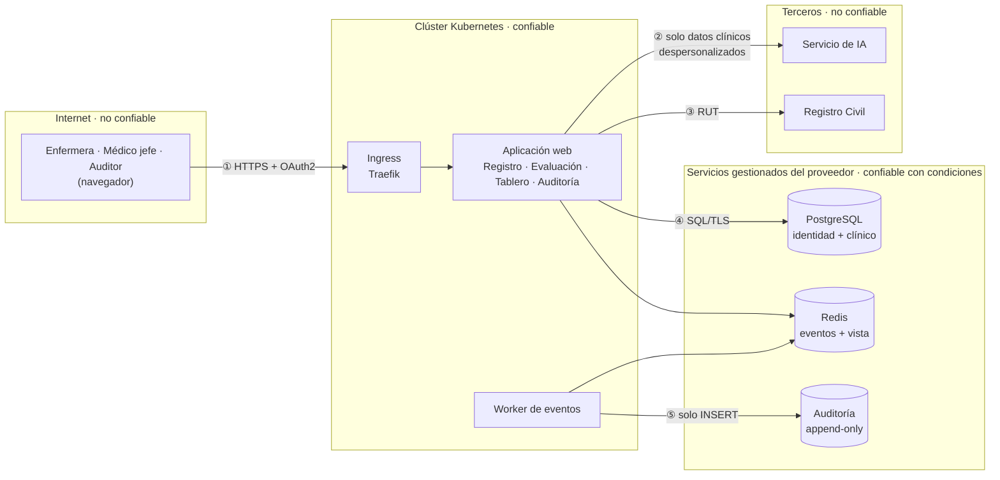

# Threat model — flujo de triage de MediTriage

Modelo de amenazas STRIDE del flujo crítico del sistema. Responde tres preguntas: **qué
protegemos, por dónde nos pueden atacar y qué lo impide**.

| | |
|---|---|
| **Alcance** | El flujo de triage completo: registro del paciente, evaluación con el servicio de IA externo, confirmación de la categoría y registro en auditoría |
| **Método** | STRIDE por elemento, con priorización por probabilidad e impacto |
| **Fecha** | 06/11/2026 · sesión 09 |
| **Autor** | Fernando Ureta (Tech Lead) |
| **Revisión** | En cada release mayor, o cuando cambie un límite de confianza (regla de la sesión 09) |

**Por qué el flujo y no un microservicio.** La sesión pide aplicar STRIDE a un microservicio.
MediTriage es un monolito modular (ADR 0002), así que se modela su flujo crítico: es el que
toca datos de salud, cruza el límite hacia el servicio de IA externo y produce las decisiones
que la ley obliga a auditar.

## 1. Qué protegemos

| Activo | Por qué importa | Dónde vive |
|---|---|---|
| **Identidad del paciente**: RUT, nombre, consentimiento | Dato personal protegido por la Ley 19.628 y la Ley 21.719 | Contexto de identidad (PostgreSQL) |
| **Datos clínicos**: signos vitales, síntomas | Dato sensible de salud | Contexto clínico (PostgreSQL) |
| **La decisión de triage**: categoría ESI y su justificación | Define quién se atiende primero. Si se altera, puede costar una vida | Contexto clínico y auditoría |
| **El registro de auditoría** | Obligatorio e inmutable por 5 años | Almacén de auditoría, base separada (ADR 0004) |
| **Credenciales**: tokens OAuth2, clave del servicio de IA, accesos a las bases | Abren todo lo anterior | Secrets de Kubernetes (ADR 0005) |
| **Disponibilidad del servicio** | El compromiso es 99,5% mensual; sin sistema, el triage vuelve al papel | Clúster de Kubernetes |

## 2. Límites de confianza

Un **límite de confianza** es el punto donde los datos pasan de una zona que controlamos a una
que no, o al revés. Es donde se concentran las amenazas.

| # | Límite | Qué lo cruza | Por qué es delicado |
|---|---|---|---|
| ① | Internet → Ingress | Todas las solicitudes de los usuarios | Es la única puerta pública |
| ② | Aplicación → servicio de IA | Datos clínicos | Es un tercero: no controlamos qué hace con los datos ni qué responde |
| ③ | Aplicación → Registro Civil | El RUT | Sale un identificador personal fuera del sistema |
| ④ | Aplicación → bases gestionadas | Todos los datos | El proveedor opera la infraestructura |
| ⑤ | Worker → auditoría | Las decisiones | Quien escriba aquí podría falsear la historia legal del sistema |

## 3. Amenazas por categoría STRIDE

Cada amenaza tiene un **estado**:

- ✅ **Implementado**: existe en el código, la configuración o el pipeline, y se puede verificar
- 📐 **Diseñado**: está decidido en un ADR o en el contrato, pero aún no implementado
- ❌ **Falta**: no existe ni está decidido

### S — Spoofing (suplantación)

*Alguien se hace pasar por otro.*

| ID | Amenaza | Control | Estado |
|---|---|---|---|
| S1 | Alguien sin cuenta registra pacientes o lee datos clínicos, haciéndose pasar por una enfermera | OAuth2 con flujo *authorization code* y un *scope* por operación (`pacientes:write`, `triage:write`, `triage:read`, `auditoria:read`), definido en `api/openapi.yaml` | 📐 Está en el contrato, pero **la aplicación aún no valida tokens** (marcado `PENDIENTE` en el #67) |
| S2 | Un atacante se interpone entre la aplicación y el servicio de IA y devuelve una categoría falsa | TLS con verificación de certificado. Además, **la IA sugiere y la enfermera decide**: la evaluación y la categoría final son entidades separadas (DER) y una categoría distinta exige justificación | 📐 Diseñado (DER, contrato) |
| S3 | Un proceso se hace pasar por el worker y escribe registros de auditoría falsos | Credencial de base de datos exclusiva del worker, con permiso solo de `INSERT` (ADR 0004, sección 5) | 📐 Diseñado |

### T — Tampering (alteración)

*Alguien modifica datos o código.*

| ID | Amenaza | Control | Estado |
|---|---|---|---|
| T1 | Se modifica o borra un registro de auditoría para ocultar una decisión | Cuatro capas (ADR 0004): permisos solo `INSERT`, trigger que rechaza `UPDATE` y `DELETE`, cadena de hashes (`hashIntegridad` en el contrato) y respaldos WORM por 5 años | 📐 Diseñado |
| T2 | Se altera un evento mientras viaja por Redis | TLS hacia Redis. PostgreSQL es la fuente de verdad (Outbox), y la auditoría se reconcilia contra la tabla outbox (ADR 0004) | 📐 Diseñado |
| T3 | Se despliega una imagen o un manifiesto alterado | Imágenes base fijadas por digest, imagen propia referenciada por digest en `k8s/deployment.yaml`, rama `main` protegida con revisión obligatoria | ✅ Implementado. **La firma de imágenes queda para la S10** |
| T4 | Se cambia la categoría sugerida por la IA sin dejar rastro del motivo | Regla de dominio `justificacion-requerida` (422) en el contrato | 📐 Diseñado |

### R — Repudiation (negar una acción)

*Alguien niega haber hecho algo, y no hay cómo probarlo.*

| ID | Amenaza | Control | Estado |
|---|---|---|---|
| R1 | Una enfermera niega haber cambiado la categoría que sugirió la IA | La categoría final guarda su origen y su justificación (DER). **Pero el registro de auditoría (`Decision` en el contrato) no guarda quién confirmó la categoría** | ❌ **Falta**: agregar al contrato una referencia opaca a quien decidió. Es un cambio compatible según la política de versionado |
| R2 | Disputa sobre qué respondió exactamente la IA | Se guarda la respuesta original de la IA (DER, `respuesta_ia_original`), el `trace_id` de cada solicitud y la versión del contrato | ✅ El `trace_id` está implementado · 📐 lo demás, diseñado |

### I — Information disclosure (filtración)

*Datos llegan a quien no debe verlos.*

| ID | Amenaza | Control | Estado |
|---|---|---|---|
| I1 | El RUT o el nombre aparecen en los logs | Regla Semgrep `meditriage-pii-en-logs`, bloqueante (#95). Las respuestas devuelven el RUT enmascarado | ✅ Implementado y probado |
| I2 | Datos personales viajan hacia el servicio de IA | Regla Semgrep `meditriage-pii-hacia-servicio-externo` (#95). El contexto clínico solo guarda el `paciente_id` (DER, ADR 0002) | ✅ Implementado y probado |
| I3 | Un mensaje de error muestra detalles internos | Errores RFC 7807 con textos propios. Regla Semgrep `meditriage-error-filtra-excepcion` (#95) | ✅ Implementado y probado |
| I4 | Una credencial queda en el repositorio | gitleaks sobre todo el historial (#90, #91). `.gitignore` y `.dockerignore` en lista blanca | ✅ Implementado |
| I5 | Una dependencia con una vulnerabilidad conocida filtra datos | SCA con Trivy, bloqueante (#92). SBOM de la imagen (#93) | 📐 En curso (S09) |
| I6 | El tráfico viaja sin cifrar | En producción, TLS en el Ingress y hacia los servicios gestionados (ADR 0003). **En el clúster local, el Ingress usa HTTP.** Los Secrets de Kubernetes no se cifran por defecto (ADR 0005) | ❌ Falta configurar TLS en el Ingress de producción |
| I7 | **Enumeración de pacientes**: registrar un RUT ya existente responde `409 paciente-ya-registrado` con su `pacienteId`, lo que revela que esa persona se atiende en la red | El endpoint exige el scope `pacientes:write`, que solo tienen las enfermeras de triage | ⚠️ **Riesgo aceptado** mientras la autenticación funcione (depende de S1). Se registran los intentos |

### D — Denial of service (denegación de servicio)

*Alguien deja el sistema sin funcionar.*

| ID | Amenaza | Control | Estado |
|---|---|---|---|
| D1 | Se satura el endpoint de evaluación, que además consulta un servicio de pago | 3 réplicas y HPA (#70). **Falta un límite de solicitudes por usuario** en el Ingress | ❌ Falta el límite de solicitudes |
| D2 | El servicio de IA se cae o tarda más de 3 segundos | Derivación a triage manual (HU06): el sistema sigue funcionando sin la IA | 📐 Diseñado (contrato) |
| D3 | Redis se llena o se cae | Redis sin expulsión de claves (`noeviction`). El triage no pasa por Redis: escribe en PostgreSQL (ADR 0004) | 📐 Diseñado |
| D4 | Solicitudes con cuerpos enormes | Largos máximos validados en cada campo (`nombre` ≤ 200, `observacion` ≤ 500). **Falta un tamaño máximo de cuerpo** en el Ingress | ✅ Validación implementada · ❌ falta el límite del Ingress |

### E — Elevation of privilege (escalamiento de privilegios)

*Alguien obtiene permisos que no le corresponden.*

| ID | Amenaza | Control | Estado |
|---|---|---|---|
| E1 | Una enfermera consulta el historial de auditoría | Scope `auditoria:read` exclusivo del auditor clínico, y error `acceso-denegado` (HU05) | 📐 Diseñado (depende de S1) |
| E2 | Quien comprometa la aplicación toma control del contenedor o del nodo | Imagen distroless **sin shell**, usuario **no root** (uid 65532), verificado en el #68. **Pero `k8s/deployment.yaml` no declara un `securityContext`**: Kubernetes no lo exige ni lo verifica. Si la imagen cambiara por una que corre como root, se ejecutaría igual, y el contenedor conserva los privilegios por defecto del runtime | ✅ Imagen · ❌ falta el `securityContext` |
| E3 | Un pipeline comprometido usa sus permisos para publicar código malicioso | Permisos mínimos: `contents: read` por defecto y `packages: write` solo en el job que publica. El token del pipeline es temporal | ✅ Implementado |

## 4. Priorización

Probabilidad e impacto, de 1 (bajo) a 3 (alto). Riesgo = probabilidad × impacto.

| ID | Amenaza | Prob. | Impacto | Riesgo | Estado |
|---|---|---|---|---|---|
| **S1** | Acceso sin autenticación | 3 | 3 | **9** | 📐 |
| **E2** | Contenedor sin `securityContext` | 2 | 3 | **6** | ❌ |
| **R1** | Auditoría sin el autor de la decisión | 2 | 3 | **6** | ❌ |
| **D1** | Saturación del endpoint de evaluación | 2 | 2 | 4 | ❌ |
| **T1** | Alteración de la auditoría | 1 | 3 | 3 | 📐 |
| **I6** | Tráfico sin cifrar en producción | 1 | 3 | 3 | ❌ |
| **I7** | Enumeración de pacientes | 1 | 2 | 2 | ⚠️ aceptado |

**S1 es el riesgo más alto, y del que dependen otros tres** (I7, E1 y la mitad de R1): mientras
la aplicación no valide tokens, los scopes del contrato no protegen nada.

## 5. Mitigaciones pendientes

| Prioridad | Mitigación | Amenazas | Cuándo |
|---|---|---|---|
| 1 | Validar tokens OAuth2 y scopes en la aplicación | S1, E1, I7 | Antes de exponer la aplicación fuera del clúster local |
| 2 | `securityContext` en el Deployment: `runAsNonRoot`, `readOnlyRootFilesystem`, `allowPrivilegeEscalation: false`, sin *capabilities* | E2 | Inmediato: es configuración, sin código |
| 3 | Agregar a `Decision` una referencia opaca a quien confirmó la categoría | R1 | Próximo cambio del contrato |
| 4 | Límite de solicitudes y de tamaño de cuerpo en el Ingress | D1, D4 | Sesión 16 (resiliencia) |
| 5 | TLS en el Ingress de producción y cifrado de Secrets | I6 | Al elegir proveedor cloud |
| 6 | Firma de imágenes y escaneo de la infraestructura como código | T3 | Sesión 10 (supply chain) |

## 6. Lo que este modelo no cubre

- **El comportamiento del modelo de IA**: sesgos, respuestas engañosas o *prompt injection* a
  través de los síntomas escritos por el paciente. Se tratan en la sesión 13 (LLM y RAG).
- **La seguridad del proveedor cloud**, que aún no se elige (ADR 0003).
- **Ataques físicos o de ingeniería social** sobre el personal del centro de salud.
